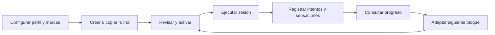

# 00. Visión y alcance

## 1. Idea de producto

**Nombre provisional:** Haltero.

**Visión:** ofrecer a quien practica halterofilia un único lugar para planificar, ejecutar, analizar y compartir su entrenamiento con una experiencia específica, rápida y comprensible.

**Propuesta de valor:** frente a una aplicación de fuerza genérica, Haltero modela intentos válidos y fallidos, variantes de movimientos olímpicos, porcentajes respecto a marcas, bloques de entrenamiento y volumen específico. Frente a una hoja de cálculo, facilita el uso durante la sesión, el histórico y la reutilización de rutinas públicas.

## 2. Problema

Quienes entrenan halterofilia suelen combinar hojas de cálculo, notas, aplicaciones generalistas y contenido disperso. Esto provoca:

- fricción al registrar intentos, variantes, RPE/RIR y resultados;
- poca visibilidad de la evolución por movimiento y por ciclo;
- dificultad para reutilizar o adaptar programas compartidos;
- recomendaciones genéricas que no respetan nivel, frecuencia, material o marcas;
- poca trazabilidad cuando una rutina compartida se copia y modifica.

Estas afirmaciones son hipótesis de producto. Deben validarse con entrevistas antes de presentarlas como conclusiones del TFM.

## 3. Usuarios

### Persona primaria: deportista autónomo

- Practica halterofilia de forma recreativa o competitiva local.
- Entrena entre 2 y 5 días por semana.
- Conoce sus marcas aproximadas y la terminología básica.
- Quiere registrar rápido desde el móvil y ver progreso real.

### Persona secundaria: entrenador

- Publica programas y quiere que sean fáciles de copiar y ejecutar.
- Publica programas y puede revisar las adaptaciones realizadas por otros usuarios.
- La gestión de múltiples atletas no entra en el MVP; se considera una evolución.

### Visitante

- Consulta rutinas públicas y perfiles públicos.
- Debe registrarse para copiar una rutina o registrar entrenamientos.

## 4. Objetivos

### Objetivo general

Diseñar, implementar y evaluar una aplicación web especializada en halterofilia que combine planificación, registro de entrenamiento, análisis y comunidad.

### Objetivos específicos

1. Modelar rutinas, ciclos, sesiones, intentos y marcas con semántica propia del deporte.
2. Permitir registrar una sesión desde móvil con baja fricción.
3. Permitir publicar, descubrir y copiar rutinas sin perder autoría ni versión de origen.
4. Presentar marcas, volumen y evolución con cálculos comprensibles y reproducibles.
5. Evaluar utilidad, usabilidad, seguridad y rendimiento del producto.
6. Mantener trazabilidad entre requisitos, decisiones, implementación y pruebas.

## 5. Preguntas de investigación

- **PI1:** ¿Puede una interfaz específica reducir el tiempo y los errores al registrar una sesión de halterofilia frente al método habitual del usuario?
- **PI2:** ¿Qué información específica de halterofilia resulta más útil para valorar la evolución dentro de un ciclo?
- **PI3:** ¿El versionado y la procedencia permiten reutilizar rutinas públicas sin perder autoría ni control sobre las modificaciones?

## 6. Alcance del MVP

### Incluido

- Registro, acceso, cierre de sesión y recuperación de cuenta.
- Perfil con nivel, objetivos, disponibilidad y marcas de referencia.
- Catálogo curado de ejercicios y variantes.
- Creación y edición de rutinas organizadas por semanas y días.
- Prescripción por series, repeticiones, carga absoluta, porcentaje y/o RPE.
- Ejecución y registro de sesiones, incluidos intentos válidos y fallidos.
- Cálculo y visualización de marcas personales e histórico.
- Publicación de rutinas y perfil de autor.
- Búsqueda y filtros; copia de una rutina manteniendo procedencia.
- Exportación y eliminación de los datos personales básicos.

### Fuera del MVP

- Diagnóstico, rehabilitación o recomendación médica.
- Análisis de técnica mediante vídeo o visión artificial.
- Chat en tiempo real, seguidores, mensajería y notificaciones push.
- Pagos, suscripciones y marketplace de entrenadores.
- Integración con wearables o plataformas externas.
- Clasificaciones competitivas oficiales.
- Aplicaciones nativas iOS/Android.

## 7. Flujo principal

## 8. Principios de producto

1. **Registrar primero:** durante una sesión, la acción importante debe estar a uno o dos toques.
2. **Específico sin ser críptico:** usar vocabulario de halterofilia y explicarlo cuando sea necesario.
3. **Control del usuario:** ninguna rutina se activa o publica sin una acción explícita.
4. **Privado por defecto:** entrenamientos y datos físicos son privados salvo publicación explícita.
5. **Autoría y procedencia:** copiar una rutina crea una versión independiente y conserva el origen.
6. **Evidencia antes que promesas:** no afirmar que una planificación mejora el rendimiento sin evaluación.

## 9. Hipótesis a validar en la fase 0

| ID | Hipótesis | Método | Señal de validación inicial |
| --- | --- | --- | --- |
| H1 | Registrar intentos desde el móvil es una necesidad frecuente | 3–5 entrevistas + prueba de prototipo | ≥ 3 usuarios describen fricción actual concreta |
| H2 | Los ciclos compartidos tienen valor si se pueden adaptar | Entrevista + test de concepto | ≥ 60 % intentaría copiar una rutina adecuada a su nivel |
| H3 | Conservar autoría y versión de origen aumenta la confianza al copiar | Prueba de concepto | ≥ 60 % identifica correctamente origen y estado de su copia |
| H4 | Un MVP puede omitir vídeo y funciones sociales avanzadas | Priorización MoSCoW | Ninguna aparece como bloqueante del flujo principal |

## 10. Criterio de éxito del TFM

El trabajo se considera exitoso si entrega un MVP desplegado y reproducible, cubre el flujo principal, supera las pruebas automáticas críticas y documenta una evaluación de usabilidad y utilidad con usuarios o, si no fuera posible, una inspección experta con protocolo reproducible.
