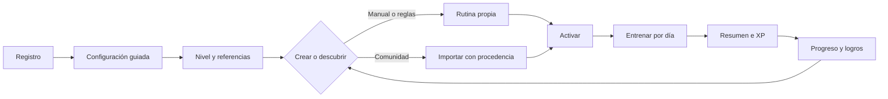

# 00. Visión y alcance

## 1. Visión de producto

Haltero es una plataforma web móvil-first especializada en halterofilia. Reúne en un único entorno la configuración del atleta, la planificación por rutinas y días, la ejecución de sesiones, el seguimiento de marcas, el aprendizaje de ejercicios y la interacción alrededor de rutinas públicas.

La propuesta se apoya en cuatro pilares concebidos como una experiencia única:

1. **Personalización inicial:** el sistema conoce disponibilidad, medidas, experiencia, objetivos y marcas antes de sugerir una planificación.
2. **Entrenamiento utilizable:** las rutinas se ejecutan por días y las series se registran con poca fricción.
3. **Progreso comprensible:** las marcas se conservan por ejercicio y rango de repeticiones, se representan en gráficos y se interpretan junto al esfuerzo y la recuperación.
4. **Comunidad con control:** cada atleta decide qué publica, puede reutilizar rutinas ajenas y mantiene la procedencia del contenido.

## 2. Problema

Quien practica halterofilia suele repartir su información entre hojas de cálculo, notas, aplicaciones genéricas y mensajes con su entrenador. Esta fragmentación dificulta:

- relacionar marcas de referencia con las cargas programadas;
- adaptar el tipo de trabajo al nivel técnico real;
- registrar intentos sin interrumpir el entrenamiento;
- comparar la sesión planificada con lo realmente ejecutado y sus sensaciones;
- visualizar la evolución de los movimientos principales;
- descubrir rutinas adecuadas por nivel y enfoque;
- reutilizar contenido sin perder autoría;
- controlar por separado qué datos personales y deportivos son públicos.

## 3. Usuarios

### Deportista en iniciación

Necesita aprender posiciones, distinguir variantes y empezar con cargas prudentes. Puede desconocer sus marcas, por lo que el sistema debe funcionar sin inventarlas.

### Deportista con experiencia

Quiere planificar varios días, trabajar por porcentajes, registrar marcas fechadas y analizar su evolución.

### Autor de rutinas

Diseña y publica planificación, recibe likes y preguntas, responde a otros atletas y conserva la atribución cuando su rutina se importa.

### Visitante autenticado de la comunidad

Explora rutinas y perfiles públicos, filtra por nivel y enfoque, consulta progresión cuando el propietario la comparte e importa una rutina a su biblioteca.

## 4. Objetivos

### Objetivo general

Diseñar, implementar y evaluar una aplicación web especializada en halterofilia que combine personalización, planificación, registro, aprendizaje, progreso y comunidad con privacidad por diseño.

### Objetivos específicos

1. Modelar perfiles, niveles, marcas, ejercicios, rutinas versionadas, días, sesiones e interacciones sociales.
2. Proponer cargas solo a partir de referencias compatibles y explicar la ausencia de datos.
3. Permitir crear rutinas manualmente o mediante reglas deterministas revisables.
4. Registrar sesiones desde móvil y conservar intentos, carga planificada/realizada, repeticiones, RPE y sensaciones.
5. Mostrar evolución fechada, récords por repeticiones y estimaciones diferenciadas de sentadilla, sentadilla frontal, arrancada, dos tiempos y sus variantes.
6. Permitir publicar, descubrir, importar y activar rutinas sin perder procedencia.
7. Dar al usuario control granular sobre perfil, datos de entrenamiento, progreso y rutinas.
8. Reforzar adherencia mediante notificaciones, experiencia y logros sin convertirlos en criterio deportivo.
9. Ofrecer la interfaz en español e inglés.
10. Mantener trazabilidad entre requisitos, código, migraciones y pruebas.

## 5. Preguntas de investigación

- **PI1:** ¿Una interfaz específica reduce la fricción al registrar una sesión de halterofilia?
- **PI2:** ¿La combinación de experiencia, peso corporal y marcas ofrece un punto de partida comprensible para clasificar el nivel?
- **PI3:** ¿Las recomendaciones deterministas y explicables generan más confianza que una carga sin referencia visible?
- **PI4:** ¿La procedencia, el perfil del autor y la conversación asociada ayudan a decidir si una rutina pública es adecuada?
- **PI5:** ¿Los gráficos, logros y notificaciones favorecen la continuidad sin ocultar los datos reales?

## 6. Alcance funcional

### Cuenta y configuración

- Registro, inicio y cierre de sesión.
- Configuración guiada de días de entrenamiento, altura, peso y experiencia.
- Objetivos multiselección: técnica, fuerza, movilidad y competición.
- Avatar opcional comprimido y almacenado como base64.
- Marcas opcionales; opción explícita «Lo desconozco».
- Cálculo de nivel: iniciación, principiante, intermedio y avanzado.
- Edición posterior desde Perfil y preferencia de idioma.

### Planificación y ejecución

- Rutinas propias editables, eliminables, públicas o privadas.
- Días independientes con nombre y ejercicios propios.
- Creación manual y asistente por reglas.
- Series, repeticiones, carga o porcentaje, descanso y notas.
- Activación exclusiva de una rutina por usuario.
- Sesión activa con pausa, reanudación y estado por serie.
- RPE por serie y cierre con dolor, fatiga, sensación general y notas.
- Resumen de volumen planificado/realizado, rendimiento, duración y resultados.

### Aprendizaje y progreso

- Enciclopedia por fuerza básica, movilidad, arrancada y dos tiempos.
- Variantes desde hang, bloques, potencia, pausa, tempo, déficit, complejos y auxiliares.
- Descripción, enfoque, claves técnicas, material y espacio para vídeo.
- Registro fechado y gráficos de las cuatro marcas de referencia.
- 1RM, 2RM, 3RM y 5RM por ejercicio, confirmación opcional y estimación explícita de 1RM.
- Aviso descriptivo ante una caída sostenida del rendimiento de varias sesiones.
- Estadísticas de volumen semanal, intensidad relativa, distribución fuerza/técnica/movilidad, total olímpico y relación con el peso corporal.

### Comunidad

- Catálogo de rutinas públicas filtrable por nivel del autor y enfoque.
- Likes, preguntas y respuestas.
- Importación como copia independiente y activación.
- Perfil público del autor.
- Privacidad independiente para datos de entrenamiento, progreso y rutinas.
- Notificaciones para likes y preguntas recibidas.
- XP, nivel de cuenta, historial de experiencia y logros.

### Asistencia

- Entrenador conversacional gratuito basado en reglas y en el contexto del perfil, rutina activa, historial, marcas y enciclopedia.
- Respuestas acotadas a los datos disponibles.
- Sin generación opaca de cargas ni sustitución de asesoramiento profesional.

## 7. Fuera de alcance

- Diagnóstico, rehabilitación o tratamiento médico.
- Análisis automático de vídeo.
- Chat privado en tiempo real, seguidores o mensajería directa.
- Pagos, marketplace y gestión comercial de clientes.
- Integración con wearables.
- Clasificación deportiva oficial.
- Aplicaciones nativas.
- Prescripción generativa autónoma sin supervisión.

## 8. Flujo principal

## 9. Principios de producto

1. **Privado por defecto:** publicar exige una decisión explícita.
2. **Sin datos inventados:** una marca ausente produce 0 kg y una indicación técnica, nunca una falsa recomendación.
3. **Explicabilidad:** las cargas calculadas indican porcentaje y marca utilizada.
4. **Control del atleta:** toda propuesta se puede editar antes de guardar o activar.
5. **Procedencia:** importar conserva versión y autor de origen.
6. **Separación de niveles:** el nivel deportivo no es el nivel de cuenta por XP.
7. **Progreso verificable:** los gráficos se construyen con registros fechados.
8. **Interfaz inclusiva:** español e inglés, móvil y escritorio, teclado y etiquetas accesibles.
9. **Gamificación no clínica:** los logros reconocen uso y constancia, no certifican capacidad deportiva.
10. **Seguridad junto al dato:** las políticas RLS son la barrera de autorización principal.

## 10. Criterio de éxito

El TFM se considera satisfactorio si el MVP desplegado permite completar el flujo principal, protege los datos mediante RLS, mantiene procedencia al importar rutinas, no calcula cargas sin referencia, compila de forma reproducible y aporta evidencia de evaluación técnica y de usabilidad.
