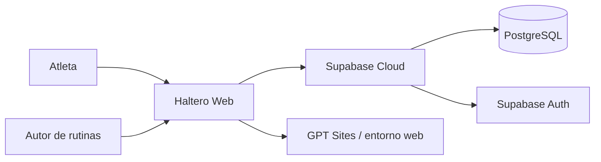
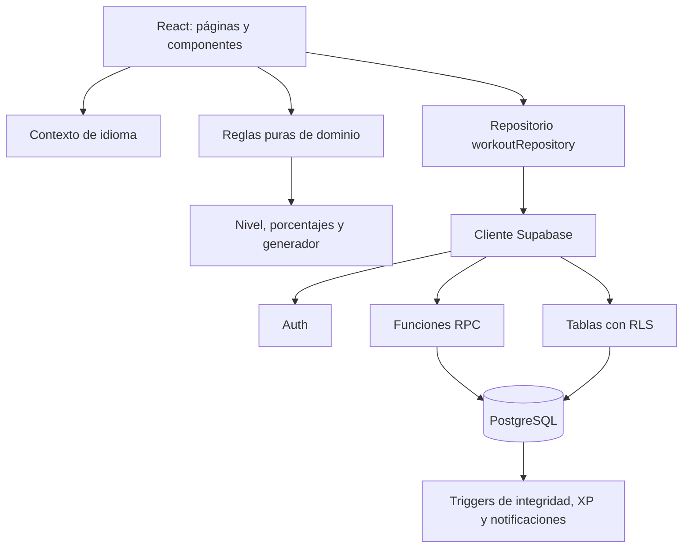

# 02. Arquitectura y tecnologías

## 1. Criterios

La solución se diseña para una única persona desarrolladora, despliegue económico, datos privados por usuario, interfaz móvil-first y evolución progresiva. Se priorizan tipado, SQL versionado, autorización cercana al dato y reglas deportivas explicables.

## 2. Vista de contexto

## 3. Arquitectura lógica

Haltero sigue un monolito modular en el frontend con Supabase como backend gestionado.

### Límites

- `web/app/page.tsx`: orquestación de sesión, navegación y vistas.
- `web/components`: capacidades visuales de rutina, calendario, progreso, enciclopedia, entrenador, notificaciones, logros y perfil público.
- `web/lib/workout/types.ts`: contratos del dominio.
- `web/lib/workout/lifts.ts`: marcas, nivel deportivo y utilidades.
- `web/lib/workout/routine-generator.ts`: generación determinista y explicable.
- `web/lib/workout/repository.ts`: único adaptador principal entre UI y Supabase.
- `supabase/migrations`: esquema, funciones, datos semilla, triggers, grants y RLS.

## 4. Stack real

| Capa | Tecnología | Uso |
| --- | --- | --- |
| Lenguaje | TypeScript 5.9 | UI, tipos y reglas |
| Framework | React 19 + App Router compatible con Next.js mediante Vinext | Aplicación web |
| Build | Vite 8 + Vinext | Compilación para entorno compatible con Cloudflare/GPT Sites |
| UI | Tailwind CSS 4, shadcn, Base UI y Lucide | Componentes y sistema visual |
| Gráficos | Recharts | Evolución de marcas |
| Persistencia | PostgreSQL de Supabase | Datos relacionales y funciones |
| Identidad | Supabase Auth | Email y contraseña, sesión |
| Autorización | Row Level Security | Propiedad y privacidad por fila |
| Cliente de datos | `@supabase/supabase-js` | Auth, consultas y RPC |
| Hosting | GPT Sites | Despliegue web |
| Base de datos | Supabase Cloud | Única base de ejecución actual |
| Calidad | TypeScript, Oxlint y build de producción | Validación estática |

Las versiones exactas están bloqueadas en `web/package-lock.json`.

## 5. Flujos de datos

### Configuración inicial

1. Auth crea la identidad.
2. `ensure_user_onboarding()` aprovisiona perfil y rutina base cuando procede.
3. La UI recoge datos y comprime el avatar.
4. El nivel se calcula en cliente con una función pura y se valida por checks de base de datos.
5. Las marcas conocidas se insertan en `lift_records`.
6. Se asigna una rutina inicial compatible.

### Rutina asistida

1. La UI recibe nivel, objetivo, días y marcas.
2. El generador selecciona reglas por nivel y enfoque.
3. Cada ejercicio usa exclusivamente su referencia asociada.
4. La carga se redondea a 2,5 kg.
5. Si no existe marca, se devuelve 0 kg y una explicación.
6. El usuario edita el borrador y decide si guardarlo o publicarlo.

### Comunidad

1. Las funciones RPC exponen solo rutinas y perfiles autorizados.
2. Importar crea una rutina propia con procedencia.
3. Likes y preguntas se escriben bajo identidad autenticada.
4. Triggers generan notificaciones y XP para el propietario.
5. Las claves de evento garantizan idempotencia.

### Finalización de sesión y nuevas marcas

1. La UI sincroniza las series editadas antes de solicitar la finalización.
2. El diálogo de cierre recoge dolor, fatiga, sensación general y notas; `finish_workout_session_v2()` valida propiedad y rangos.
3. La función completa la sesión y obtiene la mejor serie satisfactoria de 1, 2, 3 y 5 repeticiones para cada ejercicio exacto.
4. Cada candidata se compara con los récords confirmados del mismo ejercicio y repeticiones; los intentos fallidos quedan fuera.
5. La preferencia del perfil decide si la mejora queda `pending` o `confirmed`. La UI permite confirmar o descartar pendientes.
6. Los récords de repeticiones incluyen una estimación Epley de 1RM. Solo un 1RM confirmado de un movimiento canónico sincroniza `lift_records`.
7. La UI refresca historial, panel de récords, nivel deportivo y referencias de carga después de una confirmación aplicable.

### Rendimiento y recuperación

1. Cada serie conserva carga y repeticiones planificadas además de los valores realmente ejecutados y el RPE opcional.
2. El historial calcula volumen planificado y realizado, porcentaje de cumplimiento y RPE medio sin alterar los datos originales.
3. Una regla pura examina las tres sesiones más recientes con planificación comparable.
4. Se muestra un aviso si los tres porcentajes descienden y la caída acumulada alcanza diez puntos; el aviso es descriptivo, no diagnóstico.

### Estadísticas avanzadas

1. El repositorio incorpora a cada serie histórica el ejercicio, su categoría y la referencia canónica compatible.
2. `statistics.ts` agrupa en cliente los datos privados ya autorizados; no duplica agregados persistentes ni amplía permisos.
3. El volumen se agrupa por lunes y ejercicio, y la distribución cuenta series satisfactorias clasificadas como fuerza, técnica o movilidad.
4. La intensidad usa la última marca compatible cuya fecha no sea posterior a la sesión y se pondera por repeticiones.
5. La línea del total olímpico recorre las fechas de arrancada y dos tiempos conservando el último valor conocido de cada movimiento.
6. Las relaciones corporales dividen las últimas marcas y el total por el peso actual configurado en el perfil.

### Calendario y adherencia

1. El calendario obtiene un rango semanal o una rejilla mensual de 42 días y los eventos privados del usuario.
2. Cada fecha admite un entrenamiento de la rutina activa, descanso, competición o sesión libre; reprogramar conserva la fecha de origen.
3. Al iniciar un entrenamiento, `link_workout_session_to_calendar()` enlaza la sesión activa con el evento de hoy.
4. Al finalizar la sesión, un trigger completa el evento enlazado en la misma base de datos.
5. `my_adherence_summary()` calcula completados, pendientes, omitidos, porcentaje vencido, racha y semanas perfectas.

### Periodización de rutinas

Cada `routine_version` materializa todos sus días por `week_number`. `routine_days.phase` identifica acumulación, intensificación o descarga, y `percentage_adjustment` documenta los puntos aplicados respecto a la semana base. El generador es determinista: clona la estructura base, progresa únicamente prescripciones en porcentaje y conserva sin cambios las cargas absolutas. Las rutinas anteriores se expanden al aplicar la migración `202609290001`; el lector mantiene además un fallback a la semana 1 para versiones incompletas.

### Gestión de cuenta y privacidad

La recuperación utiliza `resetPasswordForEmail`, el evento `PASSWORD_RECOVERY` y `updateUser`; la contraseña nunca pasa por tablas propias. `export_my_data()` construye una instantánea JSON exclusivamente para `auth.uid()`. `delete_my_account()` exige que el correo confirmado coincida con el de `auth.users` y elimina esa identidad, apoyándose en claves foráneas con cascada para los datos personales.

### Paginación y rendimiento del cliente

`community_routines_page` aplica filtros, límite y desplazamiento antes de transferir datos. `my_notifications_page` devuelve páginas cronológicas y el contador de no leídas usa un `count` separado protegido por RLS. Las vistas de rutinas, calendario, entrenador, enciclopedia, logros y estadísticas se cargan mediante `React.lazy`; el script `scripts/check-bundle-size.mjs` mide todos los chunks cliente en bruto y gzip después del build.
6. Los cambios relevantes disparan la evaluación idempotente de logros de constancia.

## 6. Seguridad y privacidad

- `auth.uid()` es la única identidad de autorización.
- Todas las tablas de usuario tienen RLS.
- Las tablas `profiles` solo permiten lectura directa del propietario.
- Los perfiles públicos se proyectan mediante `public_athlete_profile()`.
- Las RPC sociales y de gamificación revocan acceso a `anon`.
- Las funciones `security definer` fijan `search_path`.
- Las restricciones impiden niveles, enfoques y estados no válidos.
- Las variables públicas de Supabase se limitan a URL y clave publicable.
- No existe clave de servicio en el frontend.
- Los datos físicos no se muestran si el usuario no publica el perfil y la sección.
- El avatar base64 es una decisión acotada al MVP; no se usa para archivos grandes.

## 7. Personalización y dos tipos de nivel

| Concepto | Propósito | Datos |
| --- | --- | --- |
| Nivel deportivo | Elegir complejidad y rangos de la rutina | experiencia, peso corporal y marcas |
| Nivel de cuenta | Reconocer actividad en la aplicación | XP por acciones y logros |

Ambos son independientes. El nivel de cuenta no implica competencia técnica.

## 8. Internacionalización

La preferencia `es/en` se almacena en `profiles.preferred_language`. Un contexto React entrega idioma, locale y traducción. El catálogo mantiene nombres canónicos en español y un diccionario controlado para inglés. Los textos procedentes de base de datos que no tengan traducción explícita se muestran sin alterar.

## 9. Despliegue y portabilidad

La aplicación contiene `web/.openai/hosting.json` para GPT Sites. Supabase se consume por HTTPS, por lo que la misma build puede trasladarse a otra plataforma compatible con variables de entorno y aplicaciones React/Next.js. La base de datos es reproducible mediante migraciones.

El flujo de publicación en GPT Sites exige que la versión validada exista en Git. Este repositorio no realiza commits automáticos: la persona responsable controla la historia y el momento del despliegue.

## 10. Decisiones conscientes

- Supabase remoto es la única base activa durante el MVP.
- El entrenador contextual usa reglas locales para evitar coste y respuestas opacas.
- Los avatares se almacenan en base64 por simplicidad; Storage es la evolución natural.
- Las notificaciones son internas y se consultan periódicamente; no son push.
- No se añade estado global externo mientras React local y el repositorio sean suficientes.
- Las funciones sociales complejas se encapsulan como RPC para reducir consultas inconsistentes.

## 11. Deuda y evolución

- Dividir `app/page.tsx` en módulos de capacidad.
- Añadir pruebas unitarias y E2E a la cobertura ya existente de RLS.
- Evaluar Supabase Storage si crece el uso de imágenes.
- Añadir paginación a comunidad, notificaciones e historial.
- Medir el tamaño del bundle y aplicar carga diferida a vistas pesadas.
- Incorporar un proveedor de IA solo como opción explícita, con presupuesto, guardas y trazabilidad.
