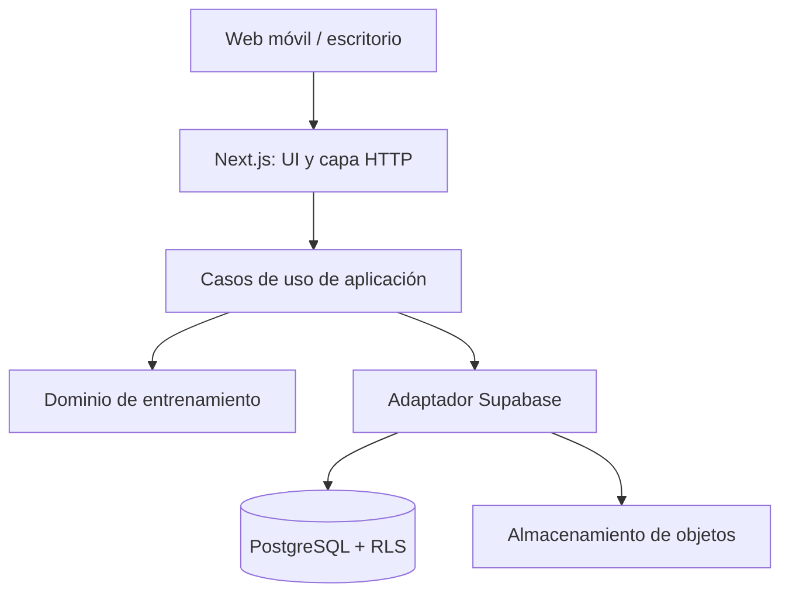

# 02. Arquitectura y tecnologías

## 1. Criterios de decisión

La selección prioriza:

1. alcance abordable por una sola persona durante un TFM;
2. tipado y validación de extremo a extremo;
3. seguridad para datos privados por usuario;
4. despliegue reproducible con bajo coste inicial;
5. tecnologías demandadas profesionalmente sin introducir microservicios innecesarios;
6. portabilidad de los datos y despliegue reproducible.

## 2. Arquitectura propuesta

Se propone un **monolito modular full-stack**. La aplicación se despliega como una unidad, pero el código separa dominio, casos de uso, infraestructura e interfaz. Esta opción reduce operaciones y mantiene límites que permitirían extraer servicios más adelante si existiera una necesidad real.



### Regla de dependencia

El dominio no conoce Next.js ni Supabase. Los casos de uso dependen de interfaces; la infraestructura implementa esas interfaces. Para el MVP no se exige una arquitectura hexagonal ceremonial: se aplicará donde proteja lógica de negocio y pruebas.

## 3. Stack elegido

| Capa | Tecnología | Uso | Justificación |
| --- | --- | --- | --- |
| Lenguaje | TypeScript estricto | Todo el código de aplicación | Unifica cliente y servidor y reduce errores de contrato. |
| Web full-stack | Next.js con App Router y React | Rutas, renderizado, acciones y endpoints | Permite Server Components para datos/secrets y componentes cliente solo en interacción; evita mantener dos proyectos. |
| UI | Tailwind CSS + shadcn/ui + Lucide | Sistema visual y componentes accesibles | Velocidad de desarrollo, control del código y consistencia sin imponer un diseño cerrado. |
| Formularios | React Hook Form + Zod | Editor de rutinas y formularios complejos | Buen manejo de secciones dinámicas y un esquema reutilizable para validar. |
| Gráficos | Recharts mediante componentes de UI | Evolución de marcas y volumen | Suficiente para las visualizaciones del MVP y compatible con React. |
| Persistencia | PostgreSQL administrado por Supabase | Datos relacionales | Rutinas versionadas y sesiones encajan bien en relaciones y transacciones. |
| Identidad | Supabase Auth | Registro y sesión | Reduce trabajo sensible de autenticación y se integra con políticas de filas. |
| Autorización | PostgreSQL Row Level Security | Privacidad por usuario/publicación | La regla vive junto al dato y añade defensa en profundidad. |
| Archivos | Supabase Storage | Avatares y posibles adjuntos | Misma identidad y políticas; solo se incorpora si el MVP lo necesita. |
| Búsqueda | PostgreSQL full-text | Portal de rutinas | Combina filtros del dominio y búsqueda textual sin añadir otro servicio al MVP. |
| Pruebas | Vitest + Testing Library + Playwright + pgTAP | Unidad, componentes, E2E y seguridad de datos | Pirámide equilibrada y comprobación específica de permisos. |
| Calidad | ESLint, Prettier, TypeScript y CI de GitHub Actions | Puertas automáticas | Feedback temprano y evidencia reproducible para la memoria. |
| Despliegue | Sitio compatible con Next.js + Supabase | Aplicación y backend de datos | Separa cómputo web y datos sin introducir administración de servidores. |

No se fijan números de versión en este documento: se bloquearán en el gestor de paquetes al iniciar el desarrollo y se registrarán en la memoria. Así no se confunde una decisión arquitectónica con una versión que envejece.

## 4. Por qué no otras alternativas

### React SPA + API independiente

Es válida, pero duplica configuración, contratos y despliegues sin que el MVP necesite escalado independiente. Se descartó a favor del monolito modular.

### Aplicación móvil nativa

Mejoraría ciertas interacciones offline y con sensores, pero exige mantener más plataforma y complica la entrega académica. Una PWA móvil-first permite validar primero el producto.

### MongoDB

La flexibilidad documental es atractiva para rutinas anidadas, pero las relaciones entre usuarios, versiones, sesiones, ejercicios y procedencia, más la necesidad de integridad, favorecen PostgreSQL.

### Firebase

Ofrece autenticación y tiempo real muy productivos. Se prefiere Supabase por SQL estándar, transacciones y autorización RLS cercana al modelo relacional.

### Microservicios

No existe un equipo ni una carga que justifique complejidad de red, observabilidad distribuida y múltiples despliegues.

## 5. Diseño del código

Estructura orientativa, pendiente de confirmar al crear el proyecto:

```text
app/                    rutas y composición de interfaz
features/
  routines/             UI y casos de uso por capacidad
  workouts/
  progress/
  community/
domain/                 entidades, reglas y tipos sin framework
infrastructure/
  db/                   repositorios y tipos generados
components/ui/          primitivas visuales
supabase/
  migrations/           esquema, grants y políticas RLS
  tests/                pruebas de acceso allow/deny
tests/                  integración y E2E
```

## 6. Seguridad y privacidad desde el diseño

- Autenticación gestionada y cookies seguras.
- Autorización tanto en caso de uso como mediante grants y RLS.
- Clave privilegiada solo en servidor y únicamente para tareas justificadas.
- Validación Zod en cada frontera no confiable.
- Limitación de frecuencia en operaciones públicas y sensibles.
- Secretos fuera del repositorio; archivo `.env.example` sin valores reales.
- Registro de errores sin contraseñas, tokens, notas privadas completas ni cuerpos de petición innecesarios.
- Perfil y sesiones privados por defecto; publicación mediante acción explícita.
- Política de conservación y borrado definida antes de pruebas con usuarios reales.

## 7. Decisiones que se aplazan conscientemente

- Modo offline/PWA instalable: se evaluará tras medir la necesidad durante entrenamientos reales.
- Almacenamiento de imágenes: no se implementará si el avatar remoto o iniciales cubren el MVP.
- Sistema de moderación: el MVP puede empezar con publicación limitada y retirada administrativa.

## 8. Fuentes técnicas consultadas

- [Next.js App Router](https://nextjs.org/docs/app): rutas por sistema de archivos, Server Components y funciones de servidor.
- [Next.js: Server and Client Components](https://nextjs.org/docs/app/getting-started/server-and-client-components): separación entre acceso a datos/secretos e interacción cliente.
- [Supabase Row Level Security](https://supabase.com/docs/guides/database/postgres/row-level-security): combinación de grants, políticas y pruebas de acceso.

Estas fuentes justifican capacidades, no sustituyen la comparación crítica ni congelan versiones.
