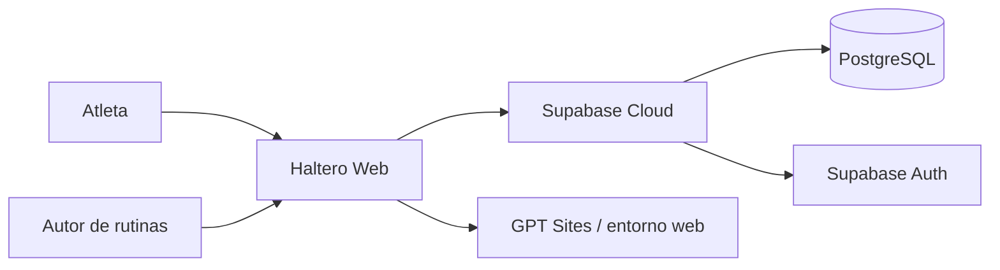
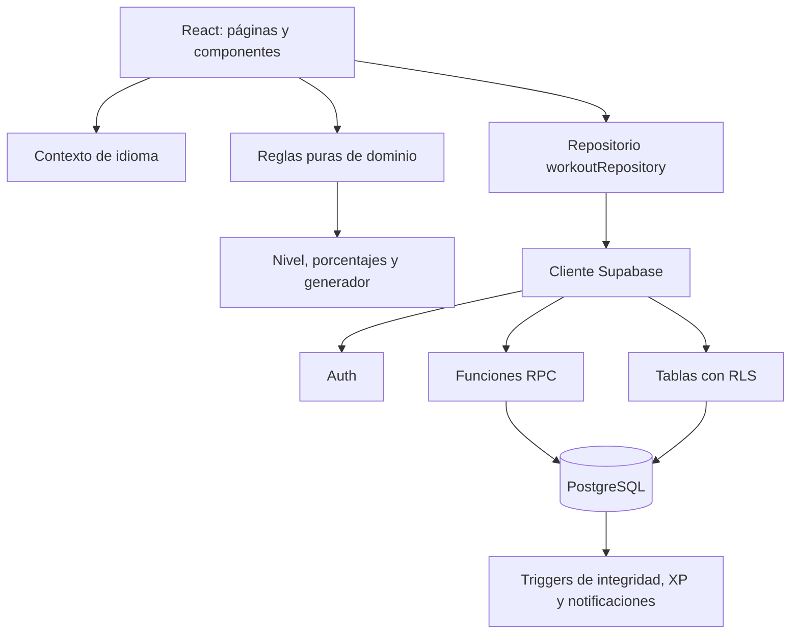

# 02. Arquitectura y tecnologías

## 1. Criterios

La solución se diseña para una única persona desarrolladora, despliegue económico, datos privados por usuario, interfaz móvil-first y evolución progresiva. Se priorizan tipado, SQL versionado, autorización cercana al dato y reglas deportivas explicables.

## 2. Vista de contexto

## 3. Arquitectura lógica

Haltero sigue un monolito modular en el frontend con Supabase como backend gestionado.

### Límites

- `web/app/page.tsx`: orquestación de sesión, navegación y vistas.
- `web/components`: capacidades visuales de rutina, progreso, enciclopedia, entrenador, notificaciones, logros y perfil público.
- `web/lib/workout/types.ts`: contratos del dominio.
- `web/lib/workout/lifts.ts`: marcas, nivel deportivo y utilidades.
- `web/lib/workout/routine-generator.ts`: generación determinista y explicable.
- `web/lib/workout/repository.ts`: único adaptador principal entre UI y Supabase.
- `supabase/migrations`: esquema, funciones, datos semilla, triggers, grants y RLS.

## 4. Stack real

| Capa | Tecnología | Uso |
| --- | --- | --- |
| Lenguaje | TypeScript 5.9 | UI, tipos y reglas |
| Framework | React 19 + App Router compatible con Next.js mediante Vinext | Aplicación web |
| Build | Vite 8 + Vinext | Compilación para entorno compatible con Cloudflare/GPT Sites |
| UI | Tailwind CSS 4, shadcn, Base UI y Lucide | Componentes y sistema visual |
| Gráficos | Recharts | Evolución de marcas |
| Persistencia | PostgreSQL de Supabase | Datos relacionales y funciones |
| Identidad | Supabase Auth | Email y contraseña, sesión |
| Autorización | Row Level Security | Propiedad y privacidad por fila |
| Cliente de datos | `@supabase/supabase-js` | Auth, consultas y RPC |
| Hosting | GPT Sites | Despliegue web |
| Base de datos | Supabase Cloud | Única base de ejecución actual |
| Calidad | TypeScript, Oxlint y build de producción | Validación estática |

Las versiones exactas están bloqueadas en `web/package-lock.json`.

## 5. Flujos de datos

### Configuración inicial

1. Auth crea la identidad.
2. `ensure_user_onboarding()` aprovisiona perfil y rutina base cuando procede.
3. La UI recoge datos y comprime el avatar.
4. El nivel se calcula en cliente con una función pura y se valida por checks de base de datos.
5. Las marcas conocidas se insertan en `lift_records`.
6. Se asigna una rutina inicial compatible.

### Rutina asistida

1. La UI recibe nivel, objetivo, días y marcas.
2. El generador selecciona reglas por nivel y enfoque.
3. Cada ejercicio usa exclusivamente su referencia asociada.
4. La carga se redondea a 2,5 kg.
5. Si no existe marca, se devuelve 0 kg y una explicación.
6. El usuario edita el borrador y decide si guardarlo o publicarlo.

### Comunidad

1. Las funciones RPC exponen solo rutinas y perfiles autorizados.
2. Importar crea una rutina propia con procedencia.
3. Likes y preguntas se escriben bajo identidad autenticada.
4. Triggers generan notificaciones y XP para el propietario.
5. Las claves de evento garantizan idempotencia.

## 6. Seguridad y privacidad

- `auth.uid()` es la única identidad de autorización.
- Todas las tablas de usuario tienen RLS.
- Las tablas `profiles` solo permiten lectura directa del propietario.
- Los perfiles públicos se proyectan mediante `public_athlete_profile()`.
- Las RPC sociales y de gamificación revocan acceso a `anon`.
- Las funciones `security definer` fijan `search_path`.
- Las restricciones impiden niveles, enfoques y estados no válidos.
- Las variables públicas de Supabase se limitan a URL y clave publicable.
- No existe clave de servicio en el frontend.
- Los datos físicos no se muestran si el usuario no publica el perfil y la sección.
- El avatar base64 es una decisión acotada al MVP; no se usa para archivos grandes.

## 7. Personalización y dos tipos de nivel

| Concepto | Propósito | Datos |
| --- | --- | --- |
| Nivel deportivo | Elegir complejidad y rangos de la rutina | experiencia, peso corporal y marcas |
| Nivel de cuenta | Reconocer actividad en la aplicación | XP por acciones y logros |

Ambos son independientes. El nivel de cuenta no implica competencia técnica.

## 8. Internacionalización

La preferencia `es/en` se almacena en `profiles.preferred_language`. Un contexto React entrega idioma, locale y traducción. El catálogo mantiene nombres canónicos en español y un diccionario controlado para inglés. Los textos procedentes de base de datos que no tengan traducción explícita se muestran sin alterar.

## 9. Despliegue y portabilidad

La aplicación contiene `web/.openai/hosting.json` para GPT Sites. Supabase se consume por HTTPS, por lo que la misma build puede trasladarse a otra plataforma compatible con variables de entorno y aplicaciones React/Next.js. La base de datos es reproducible mediante migraciones.

El flujo de publicación en GPT Sites exige que la versión validada exista en Git. Este repositorio no realiza commits automáticos: la persona responsable controla la historia y el momento del despliegue.

## 10. Decisiones conscientes

- Supabase remoto es la única base activa durante el MVP.
- El entrenador contextual usa reglas locales para evitar coste y respuestas opacas.
- Los avatares se almacenan en base64 por simplicidad; Storage es la evolución natural.
- Las notificaciones son internas y se consultan periódicamente; no son push.
- No se añade estado global externo mientras React local y el repositorio sean suficientes.
- Las funciones sociales complejas se encapsulan como RPC para reducir consultas inconsistentes.

## 11. Deuda y evolución

- Dividir `app/page.tsx` en módulos de capacidad.
- Añadir pruebas unitarias y E2E a la cobertura ya existente de RLS.
- Evaluar Supabase Storage si crece el uso de imágenes.
- Añadir paginación a comunidad, notificaciones e historial.
- Medir el tamaño del bundle y aplicar carga diferida a vistas pesadas.
- Incorporar un proveedor de IA solo como opción explícita, con presupuesto, guardas y trazabilidad.
