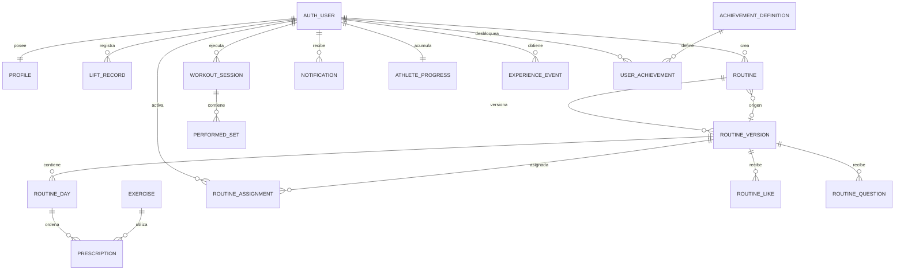

# 03. Modelo de dominio y datos

## 1. Lenguaje ubicuo

- **Nivel deportivo:** iniciación, principiante, intermedio o avanzado; orienta complejidad y carga.
- **Nivel de cuenta:** rango lúdico derivado de XP.
- **Marca de referencia:** carga fechada para uno de los cuatro levantamientos principales.
- **Ejercicio:** movimiento del catálogo con categoría, explicación y claves.
- **Rutina:** identidad lógica perteneciente a un usuario.
- **Versión:** fotografía inmutable publicable de una rutina.
- **Día:** sesión tipo independiente dentro de la versión.
- **Prescripción:** ejercicio, series, repeticiones, intensidad, descanso y notas.
- **Asignación:** versión activada por un atleta.
- **Sesión:** ejecución real de un día.
- **Serie:** resultado real, completado, fallido o pendiente.
- **Importación:** copia propia vinculada a la versión pública original.
- **Interacción:** like, pregunta o respuesta sobre una versión pública.
- **Notificación:** aviso persistente para el propietario.
- **Evento de experiencia:** concesión idempotente de XP.
- **Logro:** umbral definido por una métrica de actividad.

## 2. Relaciones



## 3. Entidades

### `profiles`

Identidad deportiva y controles de privacidad:

- nombre, biografía y avatar base64;
- nivel deportivo, experiencia, altura, peso y días;
- objetivos y configuración completada;
- idioma preferido;
- visibilidad general;
- permisos para datos, progreso y rutinas.

La lectura directa pertenece solo al propietario. La vista pública es una proyección RPC.

### `lift_records`

Contiene usuario, levantamiento, carga, fecha y origen. Los levantamientos válidos son:

- `back_squat`;
- `snatch`;
- `front_squat`;
- `clean_and_jerk`.

La combinación usuario, levantamiento y fecha es única.

El origen distingue configuración inicial, registro manual y detección desde una sesión. `finish_workout_session()` crea una fila automática únicamente cuando la carga de una serie satisfactoria en el movimiento canónico supera el máximo histórico. La finalización y el alta de marcas comparten transacción para evitar sesiones terminadas sin actualizar su progreso.

### `exercises`

Catálogo administrado con slug, nombre, material, unilateralidad y metadatos JSON:

- sección;
- resumen;
- focos;
- claves técnicas;
- URL de vídeo opcional.

Los metadatos aportan contenido editorial; la identidad y relaciones permanecen normalizadas.

### `routines`

Contiene propietario, estado y procedencia opcional. Una copia externa referencia `source_version_id`. La unicidad evita importar dos veces la misma versión para el mismo propietario.

### `routine_versions`

Contiene título, descripción, nivel, enfoque, semanas, días por semana, visibilidad y fecha de publicación. Los niveles y focos están restringidos por checks. Una versión publicada es inmutable.

### `routine_days` y `prescriptions`

Cada día tiene índice y nombre propios. Las prescripciones ordenan ejercicios y definen series, repeticiones, intensidad absoluta o porcentual, valor, carga sugerida, descanso y notas.

### `routine_assignments`

Enlaza usuario y versión activa. Un índice parcial garantiza una sola asignación `active` por usuario.

### `workout_sessions` y `performed_sets`

La sesión almacena usuario, asignación/día, inicio, fin, estado y notas. Las series guardan ejercicio, orden, carga, repeticiones, RPE opcional, resultado y tiempo.

Los slugs `sentadilla`, `arrancada`, `sentadilla-frontal` y `dos-tiempos` se corresponden de forma explícita con las cuatro marcas. Tirones, pausas, potencia, hang, bloques y demás variantes no actualizan la referencia principal.

### `training_calendar_events`

Representa un único evento por usuario y fecha. Distingue `workout`, `rest`, `competition` y `free_session`, con estado `planned`, `completed` o `skipped`. Un entrenamiento referencia un día de la rutina activa y puede quedar enlazado de forma única a su sesión real. `rescheduled_from` conserva la fecha original al moverlo.

Los eventos de descanso no entran en el denominador de adherencia. La racha considera únicamente eventos ya resueltos, por lo que un entrenamiento todavía pendiente no borra una racha anterior; un evento omitido sí la interrumpe.

### `routine_likes` y `routine_questions`

Un like es único por usuario y versión. La pregunta pertenece a su autor y admite una respuesta del propietario de la rutina.

### `notifications`

Incluye destinatario, actor, tipo, versión, pregunta opcional, fecha de lectura y clave de evento única. Tipos actuales: `routine_like` y `routine_question`.

### Gamificación

- `achievement_definitions`: catálogo bilingüe, métrica, umbral y recompensa.
- `experience_events`: libro mayor inmutable e idempotente de XP.
- `athlete_progress`: total y nivel materializados.
- `user_achievements`: logros desbloqueados y fecha.

## 4. Cálculos

### Nivel deportivo

Se calcula con experiencia y fuerza relativa respecto al peso corporal. Las marcas disponibles aportan evidencia, pero las ausentes no se estiman. La experiencia técnica limita el nivel máximo para evitar que una sentadilla alta clasifique como avanzado a quien no domina los movimientos olímpicos.

### Carga sugerida

```text
carga = redondear_a_2_5(marca_compatible × porcentaje_ajustado_por_nivel)
```

Si no existe marca compatible:

```text
carga = 0 kg
nota = empezar con barra vacía o carga técnica cómoda
```

### Volumen

```text
volumen = Σ(carga × repeticiones) de series completadas
```

Las series fallidas no suman volumen completado.

### Nivel de cuenta

```text
nivel = floor(sqrt(XP total / 250)) + 1
umbral inicial del nivel n = (n - 1)² × 250
siguiente umbral = n² × 250
```

## 5. Eventos de XP

| Evento | XP base |
| --- | ---: |
| Sesión completada | 100 |
| Marca registrada | 25 |
| Rutina publicada | 75 |
| Like externo recibido | 10 |
| Pregunta externa recibida | 15 |
| Logro desbloqueado | Recompensa de su definición |

Cada evento usa una clave única, por ejemplo `workout:<id>`, para que repetir una operación no duplique XP.

## 6. Invariantes

- Toda fila privada tiene propietario o una relación verificable con él.
- Un perfil privado no se consulta mediante la proyección pública.
- Las opciones granulares no anulan la visibilidad general privada.
- Una versión publicada no se actualiza ni elimina como borrador.
- Una copia conserva la versión exacta de origen.
- Solo hay una rutina activa por usuario.
- Una carga nunca es negativa.
- Una marca desconocida no se convierte en 60 kg ni en cualquier otro valor.
- El nivel de cuenta no cambia el nivel deportivo.
- El usuario no recibe notificación ni XP por sus propias interacciones.
- Las fechas se almacenan con zona cuando representan eventos y como fecha civil en marcas.

## 7. Política de acceso

| Recurso | Otros autenticados | Propietario |
| --- | --- | --- |
| Perfil base | Sin acceso directo | Lectura/escritura |
| Proyección pública | Según visibilidad | Completa |
| Rutina privada | Sin acceso | Lectura/escritura |
| Versión pública | Lectura social | Publicación y gestión |
| Sesiones y series | Sin acceso | Lectura/escritura |
| Marcas | Solo por proyección autorizada | Lectura/escritura |
| Notificaciones | Sin acceso | Lectura y marcado |
| XP y logros | Resumen público si perfil público | Detalle completo |
| Calendario | Sin acceso | Lectura/escritura y métricas |

## 8. Catálogo de logros

El catálogo combina hitos de adherencia, registro, progreso y comunidad:

- sesiones completadas: 1, 5, 20, 50 y 100;
- volumen válido acumulado: 1.000, 10.000, 50.000, 100.000 y 250.000 kg;
- series completadas con éxito: 50, 250 y 1.000;
- marcas fechadas: 1, 10, 25 y 50, además de cubrir los cuatro levantamientos;
- mejoras de marca personal: 1, 10 y 25;
- constancia: rachas de 3 y 10 entrenamientos y 1 o 4 semanas perfectas;
- rutinas públicas, likes y preguntas recibidas mediante umbrales crecientes.

El progreso se calcula desde los datos reales. Para el volumen solo cuentan las series con resultado satisfactorio pertenecientes a sesiones finalizadas; una serie fallida u omitida no contribuye al hito. El catálogo permanece extensible sin modificar la interfaz.
