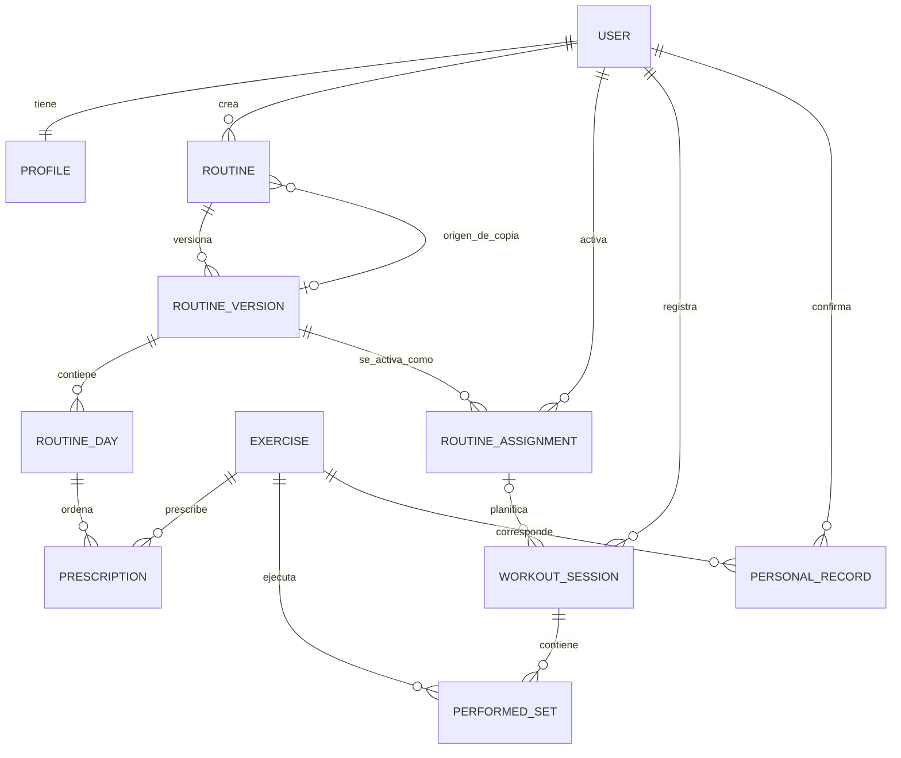

# 03. Modelo de dominio y datos

## 1. Lenguaje ubicuo

- **Ejercicio:** movimiento del catálogo, por ejemplo arrancada, dos tiempos, cargada, tirón o sentadilla.
- **Variante:** modificación de un movimiento base, por ejemplo desde bloques, colgante o power.
- **Rutina:** plantilla reutilizable de programación.
- **Versión de rutina:** instantánea inmutable que puede publicarse o copiarse.
- **Bloque/ciclo:** periodo de varias semanas con un objetivo.
- **Día programado:** conjunto ordenado de prescripciones dentro de una semana.
- **Prescripción:** ejercicio y objetivo de series, repeticiones, intensidad, RPE y descanso.
- **Asignación:** versión de rutina activada por un usuario y fechada.
- **Sesión:** ejecución real de un día, planificada o libre.
- **Serie/intento:** resultado real con carga, repeticiones, RPE y validez.
- **Marca:** mejor resultado confirmado para un ejercicio y criterio.
- **Copia (fork):** rutina nueva derivada de una versión pública, con procedencia conservada.

## 2. Relaciones principales

## 3. Entidades y campos esenciales

### `profiles`

- `user_id`, `display_name`, `bio`, `level`, `goals`, `training_days_per_week`
- `profile_visibility`, `created_at`, `updated_at`

No se almacenarán datos de salud que no sean necesarios para el caso de uso.

### `exercises`

- `id`, `slug`, `name`, `base_movement`, `category`
- `equipment`, `unilateral`, `active`, `metadata`

El catálogo es administrado. Los ejercicios personalizados quedan para una iteración posterior porque dificultan compartir y validar rutinas.

### `routines` y `routine_versions`

- `routines`: identidad lógica, propietario, estado, procedencia opcional.
- `routine_versions`: número, título, descripción, nivel, objetivo, semanas, frecuencia, visibilidad, fecha de publicación.

Una versión publicada es inmutable. Esta separación evita que las copias cambien silenciosamente.

### `routine_days` y `prescriptions`

- Día: versión, número de semana, índice del día, nombre y notas.
- Prescripción: ejercicio, orden, series, repeticiones, tipo de intensidad, valor, RPE objetivo, descanso y notas.

Si se necesitan esquemas complejos —por ejemplo, series escalonadas— se añadirá una tabla de bloques de series; no se guardará lógica opaca en texto libre.

### `workout_sessions` y `performed_sets`

- Sesión: usuario, asignación/día opcional, inicio, fin, estado y notas.
- Serie: ejercicio, prescripción opcional, orden, carga, repeticiones, RPE, resultado y sello temporal.

`result` distingue al menos `success`, `miss` y `skipped`; una omisión planificada no debe parecer un intento fallido.

### `personal_records`

- Usuario, ejercicio, tipo de marca, carga, repeticiones, fecha, serie de origen, estado de confirmación.

La serie real es la fuente de verdad cuando existe. Una marca importada manualmente conserva esa procedencia.

## 4. Invariantes

- Toda entidad privada tiene propietario comprobable.
- Ninguna versión publicada se modifica en el lugar.
- Toda prescripción referencia un ejercicio activo del catálogo.
- Una serie completada exige repeticiones y una carga no negativa.
- Un intento fallido no actualiza marcas.
- Una copia conserva la versión exacta de procedencia.
- Fechas se almacenan en UTC y se presentan en la zona del usuario.

## 5. Política de acceso inicial

| Recurso | Visitante | Usuario | Propietario | Admin |
| --- | --- | --- | --- | --- |
| Perfil privado | No | No | Lectura/escritura | Acceso justificado |
| Perfil público | Lectura | Lectura | Lectura/escritura | Moderación |
| Rutina privada | No | No | Lectura/escritura | Acceso justificado |
| Versión publicada | Lectura | Lectura/copia | Publicar/retirar | Moderación |
| Sesiones y series | No | No | Lectura/escritura | Acceso justificado |

Cada política tendrá pruebas positivas y negativas. La interfaz nunca se considera una barrera de autorización.

## 6. Decisiones de modelado por validar

- Si un complejo de halterofilia se representa como ejercicio compuesto o como agrupación de ejercicios.
- Si el RPE se registra por serie o solo al final del ejercicio.
- Cómo expresar series del tipo `3x(1+1)` sin perder búsqueda ni validación.
- Qué marcas son relevantes además del mejor intento de una repetición.
- Cómo redondear porcentajes según los discos disponibles.

Estas preguntas deben aparecer en las entrevistas con deportistas y entrenador.
