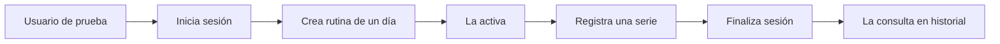

# 03. Backlog inicial

## 1. Principios de priorización

- Primero se valida el recorrido que ocurre en el gimnasio.
- Seguridad y privacidad no se aplazan a una fase de endurecimiento final.
- El portal comunitario se construye sobre rutinas ya utilizables.
- Cada entrega vertical debe poder demostrarse con datos realistas.
- “Must” significa necesario para responder a los objetivos del TFM, no simplemente deseable.

## 2. Épicas

| ID | Épica | Resultado para el usuario | Prioridad | Dependencias |
| --- | --- | --- | --- | --- |
| E-01 | Identidad y privacidad | Acceder y controlar datos propios | Must | Base técnica |
| E-02 | Catálogo de ejercicios | Usar movimientos y variantes consistentes | Must | E-01 |
| E-03 | Rutinas y ciclos | Preparar semanas y días reutilizables | Must | E-02 |
| E-04 | Sesión activa | Registrar el entrenamiento sin perder el ritmo | Must | E-03 |
| E-05 | Marcas y progreso | Comprender evolución y mejores resultados | Must | E-04 |
| E-06 | Portal de rutinas | Descubrir contenido adecuado | Must | E-03, E-01 |
| E-07 | Copia y procedencia | Adaptar sin alterar ni ocultar el original | Must | E-06 |
| E-08 | Portabilidad | Exportar y borrar datos | Must | E-01–E-05 |
| E-09 | PWA/offline acotado | Tolerar conectividad deficiente | Should | E-04 |
| E-10 | Favoritos | Guardar rutinas para revisarlas después | Should | E-06 |

## 3. Historias priorizadas

| ID | Historia resumida | Prioridad | Tamaño | Requisito |
| --- | --- | --- | --- | --- |
| US-001 | Registrarme e iniciar/cerrar sesión | Must | M | RF-001 |
| US-002 | Editar perfil, nivel, objetivos y disponibilidad | Must | S | RF-002 |
| US-003 | Mantener perfil y datos privados por defecto | Must | M | RF-003 |
| US-010 | Consultar catálogo por movimiento y variante | Must | M | RF-010–011 |
| US-011 | Registrar una marca de referencia | Must | S | RF-012 |
| US-020 | Crear metadatos de una rutina | Must | S | RF-020 |
| US-021 | Añadir semanas, días y ejercicios ordenados | Must | L | RF-021–022 |
| US-022 | Duplicar una rutina propia | Must | S | RF-023 |
| US-023 | Activar una versión de rutina | Must | M | RF-024 |
| US-030 | Iniciar una sesión programada o vacía | Must | M | RF-030 |
| US-031 | Completar una serie con carga, repeticiones y resultado | Must | M | RF-031 |
| US-032 | Cambiar ejercicios/series durante la sesión | Must | M | RF-032 |
| US-033 | Reanudar una sesión tras cerrar o recargar | Must | M | RF-033 |
| US-034 | Finalizar y consultar resumen | Must | M | RF-034 |
| US-035 | Consultar último y mejor resultado al registrar | Should | S | RNF-001 |
| US-040 | Publicar y retirar una versión | Must | M | RF-040 |
| US-041 | Buscar y filtrar rutinas públicas | Must | M | RF-041 |
| US-042 | Copiar una versión pública como rutina privada | Must | M | RF-042–044 |
| US-050 | Ver evolución por movimiento y periodo | Must | M | HU-04 |
| US-051 | Confirmar una posible marca detectada | Must | S | RF-013 |
| US-060 | Exportar mis datos | Must | M | RF-004 |
| US-061 | Eliminar mi cuenta y datos | Must | M | RF-004 |
| US-070 | Instalar la web y recuperar sesión con mala conexión | Should | L | E-09 |
| US-071 | Marcar una rutina como favorita | Should | S | E-10 |

Tamaño `S/M/L` expresa incertidumbre y esfuerzo relativo; debe recalibrarse tras el primer recorrido vertical.

## 4. Primer recorrido vertical

El primer incremento no intenta completar una épica entera. Debe probar arquitectura, permisos y experiencia básica de extremo a extremo:

### Historias incluidas

- US-001 en su variante mínima.
- US-010 con catálogo semilla reducido.
- US-020 y parte mínima de US-021.
- US-023.
- US-030, US-031 y US-034.
- Pruebas de privacidad de US-003 desde el inicio.

### Criterios de salida

- El dato persiste tras recargar.
- Dos usuarios de prueba no pueden leer ni modificar datos entre sí.
- La serie conserva vínculo con ejercicio, sesión y rutina planificada.
- El flujo funciona a 360 px y con teclado.
- Existe migración reproducible y prueba automatizada crítica.

## 5. Siguientes incrementos

### Incremento 2 — Rutina realista

Editor de varias semanas y días, porcentajes/RPE, orden, duplicación y activación estable.

### Incremento 3 — Entrenar sin fricción

Reanudación, cambios durante sesión, último/mejor, fallos, omisiones, descanso y resumen.

### Incremento 4 — Progreso

Marcas confirmadas, histórico y gráficos con cálculos verificables.

### Incremento 5 — Compartir y reutilizar

Publicación, búsqueda/filtros, detalle, copia y procedencia.

### Incremento 6 — Privacidad y entrega

Exportación/borrado, accesibilidad, rendimiento, evaluación y corrección de incidencias.

## 6. Definición de preparado

Una historia puede entrar en desarrollo cuando:

- expresa valor para un actor;
- tiene criterios de aceptación observables;
- identifica datos y permisos afectados;
- sus dependencias están resueltas o incluidas;
- existe diseño suficiente para no improvisar el flujo principal;
- cabe en una iteración o se ha dividido.

## 7. Decisiones pendientes antes de desarrollar

| ID | Pregunta | Cómo resolverla | Impacto |
| --- | --- | --- | --- |
| DP-01 | ¿Cómo se representan los complejos? | Entrevistas + prototipo de editor | Modelo de datos y UI |
| DP-02 | ¿RPE por serie o ejercicio? | Observar métodos actuales | Datos y velocidad de registro |
| DP-03 | ¿Qué significa una marca? | Validación con entrenador | Cálculos y gráficos |
| DP-04 | ¿Cómo se redondean porcentajes? | Equipamiento y preferencias | Prescripción y ejecución |
| DP-05 | ¿La rutina se publica completa o por versión? | Prototipo de procedencia | Comunidad y permisos |
| DP-06 | ¿Se requiere uso sin conexión en el gimnasio? | Entrevistas y prueba contextual | Arquitectura PWA |
| DP-07 | ¿“Haltero” es nombre final? | Búsqueda legal, dominios y test de recuerdo | Marca y publicación |

## 8. Criterio de cierre de fase 0

- [ ] Entrevistas realizadas y anonimizadas.
- [ ] Hipótesis H1–H4 y HC-01–HC-05 revisadas.
- [ ] Complejos, intentos y marcas definidos con ejemplos.
- [ ] Wireflow móvil del registro probado con al menos tres personas.
- [ ] Requisitos Must ajustados y trazables.
- [ ] Decisiones DP-01–DP-07 cerradas o aplazadas con motivo.
- [ ] Riesgos actualizados.
- [ ] Arquitectura y stack aprobados para iniciar el recorrido vertical.
