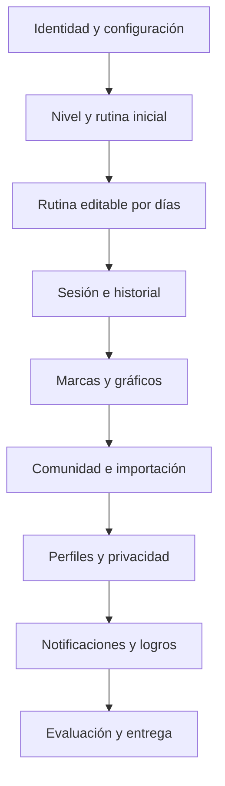

# 03. Backlog de producto

## 1. Principios

- Personalizar antes de recomendar.
- No inventar marcas ni cargas.
- Construir rutinas y días antes de añadir interacción social.
- Tratar privacidad y RLS como parte de cada historia.
- Mantener separadas capacidad deportiva y actividad lúdica.
- Acompañar cada incremento con documentación y evidencia.

## 2. Épicas

| ID | Épica | Resultado | Prioridad |
| --- | --- | --- | --- |
| E-01 | Identidad y perfil | Cuenta y datos propios protegidos | Must |
| E-02 | Configuración adaptativa | Nivel y objetivos coherentes | Must |
| E-03 | Catálogo | Conocimiento y ejercicios reutilizables | Must |
| E-04 | Rutinas por días | Planificación manual o asistida | Must |
| E-05 | Sesión activa | Registro móvil persistente | Must |
| E-06 | Marcas y progreso | Evolución fechada | Must |
| E-07 | Comunidad | Descubrir, interactuar e importar | Must |
| E-08 | Perfiles y privacidad | Identidad pública controlada | Must |
| E-09 | Notificaciones | Conocer actividad relevante | Must |
| E-10 | Logros y XP | Visualizar continuidad de uso | Must |
| E-11 | Entrenador contextual | Consultar datos propios mediante reglas | Should |
| E-12 | Multilenguaje | Usar español o inglés | Must |
| E-13 | Portabilidad | Reproducir datos y despliegue | Must |

## 3. Historias

| ID | Historia | Prioridad | Requisitos |
| --- | --- | --- | --- |
| US-001 | Crear cuenta e iniciar/cerrar sesión | Must | RF-001 |
| US-002 | Completar configuración guiada | Must | RF-002–006 |
| US-003 | Obtener nivel sin sobreestimar experiencia | Must | RF-007 |
| US-004 | Editar perfil, idioma y privacidad | Must | RF-008–010 |
| US-010 | Explorar ejercicios por sección | Must | RF-020–023 |
| US-011 | Añadir una marca desde su gráfico | Must | RF-024–025 |
| US-012 | Calcular carga solo con referencia compatible | Must | RF-026, RF-036 |
| US-020 | Crear rutina manual | Must | RF-030, RF-032–034 |
| US-021 | Crear rutina mediante reglas | Must | RF-031, RF-035–036 |
| US-022 | Configurar cada día por separado | Must | RF-033 |
| US-023 | Editar, eliminar, publicar o privatizar | Must | RF-030, RF-037 |
| US-024 | Activar una única rutina | Must | RF-038 |
| US-030 | Ejecutar, pausar y reanudar sesión | Must | RF-040–044 |
| US-031 | Finalizar y consultar resumen/historial | Must | RF-045–047 |
| US-040 | Filtrar y revisar rutinas públicas | Must | RF-050–052 |
| US-041 | Dar like y preguntar al autor | Must | RF-053–054 |
| US-042 | Importar y activar conservando procedencia | Must | RF-055–057 |
| US-043 | Abrir perfil de autor | Must | RF-058 |
| US-044 | Elegir secciones públicas | Must | RF-059 |
| US-050 | Recibir y leer notificaciones | Must | RF-060–063 |
| US-051 | Obtener XP y desbloquear logros | Must | RF-064–068 |
| US-060 | Preguntar al entrenador contextual | Should | RF-070–073 |
| US-061 | Mantener idioma entre sesiones | Must | RF-009 |

## 4. Recorridos verticales

## 5. Criterios de preparado

Una historia entra en desarrollo cuando identifica:

- actor y valor;
- aceptación observable;
- datos y permisos;
- traducción necesaria;
- estados de interfaz;
- dependencia de migración;
- prueba proporcional al riesgo.

## 6. Criterios de cierre

- La capacidad funciona con datos realistas.
- No expone filas ajenas.
- Los errores conservan el trabajo del usuario cuando procede.
- Tipos y build pasan.
- Requisitos y trazabilidad están actualizados.
- No se presenta como evaluada sin evidencia.

## 7. Backlog posterior al MVP

- exportación y borrado autoservicio;
- recuperación de contraseña;
- PWA/offline;
- detección de marcas desde series;
- paginación;
- vídeos;
- Storage para avatares;
- notificaciones push;
- IA opcional con control de coste;
- panel de entrenador.
