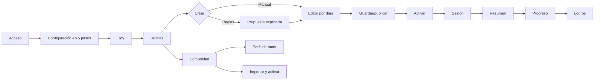

# 01. Wireflow del recorrido principal

## 1. Objetivo

Validar que un atleta puede pasar de una cuenta nueva a una rutina activa, registrar una sesión y comprender su progreso, conservando control sobre privacidad y comunidad.

## 2. Mapa general

## 3. Navegación

| Destino | Propósito |
| --- | --- |
| Hoy | Rutina activa y plan inmediato |
| Rutinas | Biblioteca propia, comunidad y creación |
| Entrenador | Consultas contextuales basadas en reglas |
| Ejercicios | Enciclopedia por familias |
| Progreso | Marcas e historial |
| Logros | XP, nivel de cuenta e insignias |
| Perfil | Datos, idioma, privacidad y cuenta |

La campana permanece accesible fuera de una sesión activa. En móvil, la navegación se presenta en la parte inferior; en escritorio, en la barra lateral.

## 4. Configuración inicial

### Paso 1 — Disponibilidad

Elegir de uno a siete días. No se presupone una semana estándar.

### Paso 2 — Medidas

Altura y peso con rango validado. El peso participa en la fuerza relativa; la altura se conserva como contexto.

### Paso 3 — Experiencia

Cuatro opciones desde «Nunca» hasta «Más de dos años». La experiencia técnica limita el nivel.

### Paso 4 — Marcas

Cuatro movimientos. Cada campo admite un peso o «Lo desconozco». No existe valor predeterminado deportivo.

### Paso 5 — Objetivos y avatar

Multiselección y foto opcional. Completar guarda nivel, perfil y referencias.

## 5. Rutinas

### Selector de modo

- **Manual:** borrador vacío y control total.
- **Asistente por reglas:** propuesta por nivel, enfoque, días y marcas.

La propuesta muestra sus supuestos, cargas, referencias ausentes y permite editar todo.

### Editor

- título, descripción, nivel, enfoque, semanas y visibilidad;
- pestañas para cada día;
- nombre independiente;
- lista propia de ejercicios;
- series, repeticiones, intensidad, descanso y nota;
- añadir o eliminar día;
- confirmación al eliminar rutina.

### Activación e importación

Activar reemplaza la asignación activa. Importar una rutina pública crea primero una copia privada con procedencia y después puede activarla.

## 6. Sesión

La sesión muestra día, progreso, ejercicios y series. Carga y repeticiones son editables. Cada serie puede marcarse como completada o fallida. El cronómetro general se puede pausar sin borrar datos. Al completar una serie, el descanso prescrito —o el respaldo del perfil— abre un contador independiente con pausa, reanudación, reinicio, ampliación de 30 segundos y descarte; su instante final se conserva al recargar.

Finalizar con pendientes exige confirmación. El resumen muestra duración, volumen, completadas, fallidas y omitidas.

## 7. Progreso

Las tarjetas de los cuatro movimientos actúan como selector. El formulario inferior hereda el levantamiento seleccionado y solo solicita peso y fecha. El gráfico usa datos reales ordenados cronológicamente.

## 8. Enciclopedia y entrenador

La enciclopedia separa fuerza, movilidad, arrancada y dos tiempos. Cada ficha explica propósito, claves y material; el vídeo es opcional.

El entrenador responde sobre el día, cargas, progresión y ejercicios a partir del contexto disponible. Si una pregunta queda fuera, explica que requeriría un modelo opcional.

## 9. Comunidad y perfiles

La comunidad permite filtrar, consultar plan, abrir autor, dar like, preguntar e importar. Un perfil público puede mostrar:

- nivel deportivo y biografía;
- nivel de cuenta, XP y logros;
- datos de entrenamiento;
- progresión;
- rutinas públicas.

Las tres últimas secciones respetan controles independientes.

## 10. Notificaciones y logros

La campana muestra contador, actor, rutina, tipo y fecha relativa. Seleccionar una notificación la marca como leída y abre Rutinas. «Leer todas» solo afecta al usuario actual.

Logros muestra nivel de cuenta, XP dentro del nivel, colección desbloqueada, objetivos pendientes y registro reciente.

## 11. Estados críticos

- sin rutina activa;
- sin sesiones;
- marca desconocida;
- rutina sin referencia compatible;
- comunidad vacía;
- perfil privado;
- sección pública deshabilitada;
- notificaciones vacías o no disponibles;
- sin logros;
- error de red;
- guardado en curso.

## 12. Reglas de interacción

1. El control principal aparece antes que información secundaria.
2. Texto de uso habitual ≥ 14 px y campos móviles ≥ 16 px.
3. Nada depende solo del color.
4. Las acciones destructivas piden confirmación.
5. Las propuestas nunca se guardan sin revisión.
6. La interfaz muestra origen y autor de copias.
7. El usuario puede volver de un diálogo sin perder el contexto.
8. Los errores secundarios no bloquean la sesión.
9. El idioma se mantiene después de recargar.
10. Teclado, foco y lector cubren los flujos críticos.

## 13. Guion breve de prueba

> Crea una cuenta, indica tres días, registra 110 kg de sentadilla y 95 kg de sentadilla frontal, deja desconocidos arrancada y dos tiempos, genera una rutina técnica, cambia el segundo día, actívala y completa una sesión. Después importa una rutina pública, pregunta al autor, revisa la notificación desde su cuenta y consulta sus logros.

Observar comprensión de marcas desconocidas, días, activación, procedencia, privacidad y diferencia entre niveles.

