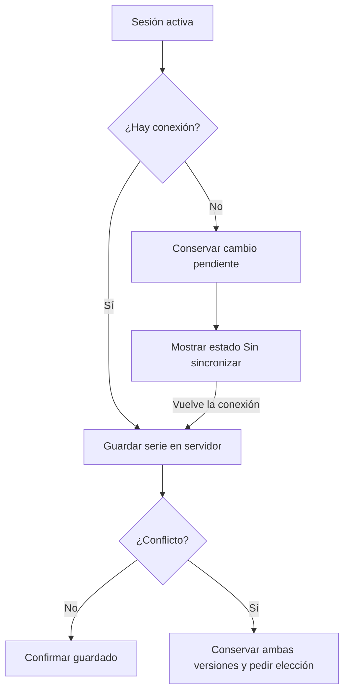

# 01. Wireflow del recorrido principal

## 1. Objetivo

Validar que una persona puede crear una rutina sencilla, activarla y registrar su primera sesión desde un móvil sin necesitar instrucciones externas.

Este wireflow es de baja fidelidad: valida orden, contenido, acciones y estados. No fija todavía la identidad visual definitiva.

## 2. Recorrido feliz

## 3. Arquitectura de navegación del MVP

Navegación inferior móvil:

| Destino | Propósito | Acción principal |
| --- | --- | --- |
| Hoy | Ver y ejecutar lo programado | Iniciar o reanudar sesión |
| Rutinas | Gestionar rutinas propias | Crear rutina |
| Explorar | Buscar rutinas publicadas | Filtrar o copiar |
| Progreso | Consultar marcas e histórico | Elegir movimiento/periodo |
| Perfil | Preferencias, privacidad y cuenta | Editar configuración |

Durante una sesión activa, la navegación general desaparece para evitar abandonos accidentales. Se mantiene una salida explícita que guarda el progreso.

## 4. Pantallas

### P01 — Mis rutinas

**Debe mostrar:** rutinas activas y borradores, objetivo, duración, frecuencia y estado.

**Acción primaria:** `Nueva rutina`.

**Acciones secundarias:** abrir, duplicar, archivar y explorar rutinas públicas.

**Estado vacío:** explica la diferencia entre crear y copiar; no presenta un panel vacío genérico.

### P02 — Datos básicos

Campos mínimos:

- nombre;
- objetivo;
- nivel recomendado;
- número de semanas;
- días por semana.

El borrador se guarda al continuar. Los detalles opcionales se posponen para evitar un formulario inicial largo.

### P03 — Editor semanal

Jerarquía visible: semana → día → ejercicio → prescripción.

Cada prescripción muestra:

- ejercicio o complejo;
- series y repeticiones;
- carga absoluta o porcentaje de una marca concreta;
- RPE opcional;
- descanso y nota opcionales.

El orden se puede cambiar, pero el arrastre no será el único mecanismo accesible. Deben existir acciones `Mover arriba` y `Mover abajo`.

### P04 — Revisión y activación

Resume duración, frecuencia, objetivo y primera semana. Señala datos incompletos antes de permitir la activación.

Activar crea una asignación con fecha de inicio; no modifica la versión de rutina. Publicar es una acción distinta y no aparece en este recorrido.

### P05 — Hoy

La primera vista útil para un usuario con rutina activa debe mostrar inmediatamente:

- semana y día actual;
- número de ejercicios y estimación de duración si existe;
- primer ejercicio;
- botón `Iniciar sesión` o `Reanudar sesión`.

No se antepone una cabecera promocional ni un resumen estadístico al entrenamiento pendiente.

### P06 — Sesión activa

Cada ejercicio muestra la prescripción, la última ejecución y las series actuales. Para registrar una serie:

1. se reutilizan carga y repeticiones previstas o anteriores;
2. el usuario modifica solo el dato que cambió;
3. marca `Completada` o `Fallida`;
4. el foco avanza a la siguiente serie y puede iniciar el descanso.

Acciones permitidas: añadir serie, añadir ejercicio, omitir, reordenar y escribir una nota. Estos cambios afectan a la sesión, no a la plantilla.

### P07 — Resumen

Muestra hechos, no juicios:

- ejercicios y series completadas/fallidas/omitidas;
- volumen calculado y su fórmula accesible;
- duración;
- posibles marcas pendientes de confirmación;
- diferencias respecto a lo planificado.

Desde aquí se accede al historial o a `Hoy`. Compartir la sesión queda fuera del MVP.

## 5. Estados alternativos

El soporte offline completo es una decisión pendiente. Incluso sin implementarlo en el MVP, la interfaz debe diferenciar `Guardando`, `Guardado`, `Sin conexión` y `Error`.

Otros estados:

- rutina sin marca necesaria para calcular porcentaje;
- ejercicio retirado del catálogo pero presente en histórico;
- sesión abandonada que puede reanudarse;
- día parcialmente completado;
- intento fallido que no genera marca;
- error al activar por datos incompletos;
- rutina pública retirada después de haber sido copiada.

## 6. Reglas de interacción

1. Una sola acción primaria visible por pantalla o bloque de decisión.
2. Objetivos táctiles de aproximadamente 44 × 44 px y campos editables con texto de al menos 16 px en móvil.
3. Ningún significado depende solo del color: `Completada`, `Fallida` y `Omitida` llevan texto o símbolo.
4. La serie no se marca automáticamente al escribir un peso.
5. Finalizar con series pendientes pide confirmación y explica qué ocurrirá.
6. Salir conserva el progreso y permite reanudar.
7. Cambiar un valor calculado a partir de porcentaje muestra la carga aplicada y la marca de referencia.
8. El temporizador ayuda, pero nunca bloquea el registro.
9. Los mensajes de guardado no desplazan controles durante la sesión.
10. Teclado, lector de pantalla y orientación vertical cubren el flujo principal.

## 7. Contenido realista para el prototipo

- Rutina: `Base técnica — 4 semanas`.
- Objetivo: técnica y consistencia.
- Frecuencia: 3 días por semana.
- Día: `Semana 1 · Día 1`.
- Arrancada: `5 × 2 al 70 %`, referencia 60 kg, carga aplicada 42 kg.
- Sentadilla frontal: `4 × 3 al 75 %`, referencia 100 kg, carga aplicada 75 kg.
- Tirón de arrancada: `3 × 3 al 90 % de arrancada`, carga aplicada 54 kg.

Estos datos son ficticios y sirven para probar la interfaz, no constituyen una recomendación de entrenamiento.

## 8. Guion de prueba del wireflow

Dar al participante esta situación, sin explicar la navegación:

> Quieres preparar una rutina de cuatro semanas y tres días. En el primer día harás arrancada 5 × 2 al 70 %. Activa la rutina, comienza la sesión, registra una serie completada con 42 kg y otra fallida, y finaliza.

Observar:

- dónde espera iniciar la creación;
- si entiende semanas/días sin explicación;
- si interpreta porcentaje y carga aplicada;
- si distingue fallo de serie incompleta;
- si sabe que cambiar la sesión no cambia la rutina;
- si encuentra cómo terminar y qué entiende del resumen.

Preguntas posteriores:

1. ¿Qué parte te hizo dudar?
2. ¿Qué esperabas que ocurriera al activar?
3. ¿Dónde buscarías la última carga utilizada?
4. ¿Qué cambio harías durante un entrenamiento real?

## 9. Criterios para iterar

- Si 2 de 3 participantes fallan la misma tarea, revisar flujo o etiqueta antes de desarrollar.
- Si la representación de complejos no se entiende, resolver DP-01 antes del modelo físico.
- Si activar/publicar se confunden, separar vocabulario y ubicación.
- Si registrar una serie supera el objetivo de acciones, rediseñar P06 antes de añadir más métricas.

